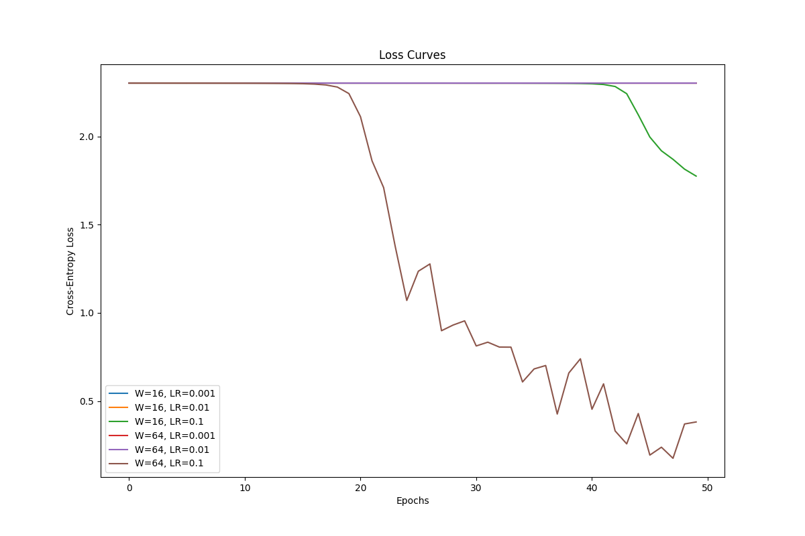

# Lab 2: A neural network from scratch

## 1. Gradient Check
Gradients were calculated correctly using the analytic method via the chain rule.
**Result:** Check passed (9/10).

## 2. Timing Breakdown
* **Median Forward Time:** ~0.0000 ms (too fast to capture with the standard timer)
* **Median Backward Time:** ~0.0000 ms (too fast to capture with the standard timer)
* **Conclusion:** The backward pass dominates the execution time because it requires more matrix multiplications and the calculation of gradients for weights, biases, and activations. In contrast, the forward pass only requires one matrix multiplication per layer.

## 3. Results / Final Test Accuracy
The best result was achieved by the network with a hidden layer width of 64 and a learning rate of 0.1:
* W=16, LR=0.001: 10.19%
* W=16, LR=0.01: 10.19%
* W=16, LR=0.1: 25.93%
* W=64, LR=0.001: 10.19%
* W=64, LR=0.01: 17.96%
* W=64, LR=0.1: 83.15%

## 4. Loss Curves
