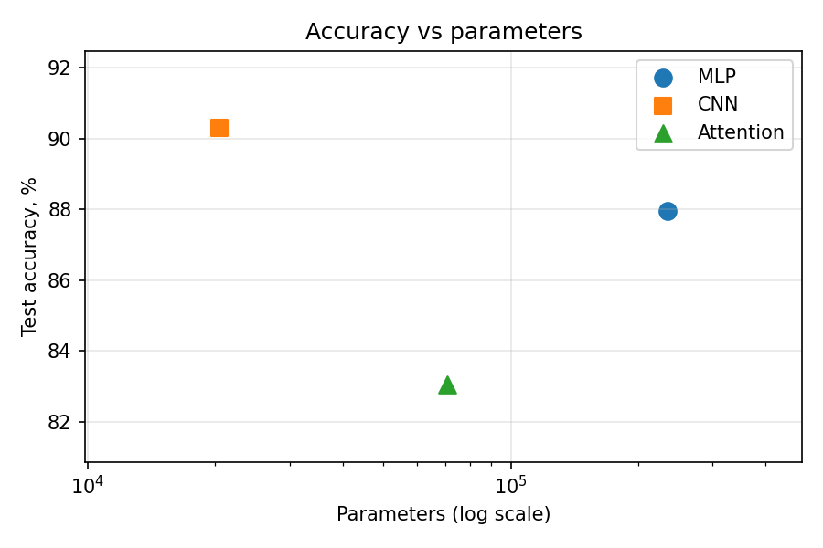
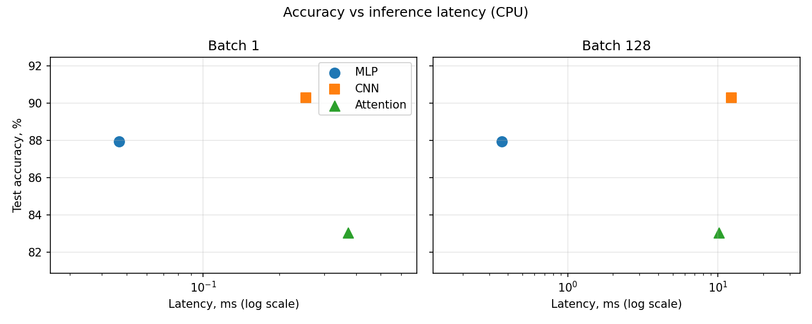

# Lab 3 — Architectures and their costs

## 1. Goal

Implement an MLP, a CNN and a small attention model for Fashion-MNIST. For each one:

* count parameters;
* calculate FLOPs by hand and compare them with `thop`;
* measure inference latency at batch 1 and batch 128;
* train for 5 epochs and record test accuracy.

Then use the Ch. 4.6–4.7 access patterns to decide which architecture is the most cost-effective.

## 2. Method

**Environment.**
* Python 3.11.8, torch 2.3.1, torchvision 0.18.1, torchinfo 1.8.0, thop 0.1.1.post2209072238.
* Windows laptop, CPU only, 2 threads.
* Seed 42 for `random`, `numpy` and `torch`.
* All code is in `src/lab03.py`. Running `python lab03/src/lab03.py` prints the library versions and every number in this report, and saves both plots to `results/`.

**Data.**
* Fashion-MNIST from `torchvision`, transformed with `ToTensor()` and `Normalize((0.2860,), (0.3530,))`.
* The official 60k training set is split into 55k train and 5k validation (seed 42).
* The official 10k test set is used for the final accuracy.
* Batch size 128.

**Models.** Implemented exactly as specified:
* **MLP**: 784 → 256 → 128 → 10 with ReLU.
* **CNN**: two Conv(3×3) + ReLU + MaxPool blocks (16 and 32 channels), then Linear 1568 → 10.
* **Attention**: 16 patches of 7×7, Linear 49 → 64, two `TransformerEncoderLayer(d_model=64, nhead=4, dim_feedforward=128)`, mean pool, Linear 64 → 10.

With these layer sizes the models do not hit the 100k–150k parameter target (see 3.1). I kept the specified architectures unchanged.

**Cost.**
* Parameters are counted with `torchinfo.summary`.
* FLOPs are calculated by hand with the Ch. 4 formulas, where 1 multiply-accumulate = 2 FLOPs, and compared with `thop.profile` (it returns MACs, so its value is multiplied by 2).
* Latency: the model is in eval mode with 10 warm-up passes, then the median of 100 runs at batch 1 and of 20 runs at batch 128.

**Training.** 5 epochs, Adam with lr 1e-3, batch 128, cross-entropy. The seed is reset before each model.

## 3. Results

### 3.1 Parameters

| Model | Calculation | torchinfo |
|---|---|---|
| MLP | (784·256+256) + (256·128+128) + (128·10+10) | **235,146** |
| CNN | (9·1·16+16) + (9·16·32+32) + (1568·10+10) | **20,490** |
| Attention | 3,200 (patch projection) + 2 × 33,472 (encoder layer) + 650 (head) | **70,794** |

### 3.2 Hand-calculated FLOPs for one layer of each type

| Layer | Formula | FLOPs |
|---|---|---|
| Linear 784→256 | 2 · 784 · 256 | 401,408 |
| Conv2d 16→32, 3×3, output 14×14 | 2 · 3 · 3 · 16 · 32 · 14 · 14 | 1,806,336 |
| Encoder layer: QKV projections | 2 · seq · d · 3d = 2 · 16 · 64 · 192 | 393,216 |
| Encoder layer: attention scores | 2 · seq² · d = 2 · 256 · 64 | 32,768 |
| Encoder layer: scores × V | 2 · seq² · d | 32,768 |
| Encoder layer: output projection | 2 · seq · d · d | 131,072 |
| Encoder layer: feed-forward | 2 · seq · d · d_ff · 2 | 524,288 |
| **Encoder layer, total** | | **1,114,112** |

### 3.3 Hand vs thop, whole model

| Model | Hand | thop × 2 | Gap |
|---|---|---|---|
| MLP | 469,504 | 469,504 | 0 |
| CNN | 2,063,488 | 2,063,488 | 0 |
| Attention | 2,329,856 | 101,632 | −95.6% |

For the MLP and CNN, thop counts exactly the matmul and convolution MACs from the formulas, so there is no gap.

For the attention model, thop reports 0 MACs for the whole encoder and counts only the patch projection (50,176 MACs) and the head (640 MACs). There are two reasons:

* `thop.profile` runs the model in eval mode without gradients. In that mode PyTorch runs each `TransformerEncoderLayer` as one fused kernel, so the inner layers are never called and thop's hooks on them never fire.
* thop has no counting rule for `nn.MultiheadAttention`, so the QKV projections, the attention scores and the output projection would be missed even without the fused kernel.

As a result, thop sees about 4% of the real work. For attention models the hand count is the reliable number.

### 3.4 Latency and accuracy

| Model | Params | FLOPs | Batch 1, ms | Batch 128, ms | Test accuracy |
|---|---|---|---|---|---|
| MLP | 235,146 | 0.47 M | **0.046** | **0.340** | 87.94% |
| CNN | 20,490 | 2.06 M | 0.163 | 11.530 | **90.29%** |
| Attention | 70,794 | 2.33 M | 0.376 | 9.814 | 83.04% |

Validation accuracy by epoch (epochs 1 → 5, %):
* MLP: 85.54, 86.98, 86.66, 88.46, 88.30
* CNN: 87.22, 88.50, 88.68, 89.84, 90.04
* Attention: 78.38, 81.24, 82.50, 83.14, 83.74

### 3.5 Trade-off plots

### 3.6 Which architecture is most cost-effective

**MLP: dense layers, weights streamed once.** Each of the 235k weights (≈ 920 KB) is read and used for one multiply per image.
* At batch 1 this is a matrix-vector product: little arithmetic per byte, but the weights fit in cache, so it is the fastest model.
* At batch 128 every weight that is loaded is reused 128 times. The time per image falls from 46 µs to 2.7 µs, a 17× gain from batching.
* Its cost is size: the most parameters of the three, but not the best accuracy.

**CNN: local sliding window, high weight reuse.** Its 80 KB of weights are reused at every one of the 784 or 196 positions in the image.
* This reuse gives the best accuracy with the fewest parameters.
* The cost moves to the activations. The first block writes a 16×28×28 feature map (49 KB per image, 6.4 MB at batch 128), and ReLU and max-pooling then read it back with almost no arithmetic.
* At batch 128 the model is limited by memory traffic, not by compute. Batching gives only 1.8×, and it is the slowest model at batch 128 (90 µs per image).

**Attention: dynamic all-to-all access.** Most of its FLOPs are in dense projections and the feed-forward block, which are matrix multiplications like in the MLP.
* With only 16 tokens, the input-dependent part (a 16×16 attention matrix per head) is small. The time goes to many small operations around it: LayerNorm, softmax, splitting into heads and reshapes. This makes it the slowest model at batch 1.
* These operations do little arithmetic and their memory traffic grows with the batch, so batching helps only 4.9× (against 17× for the MLP). At batch 128 it takes 77 µs per image, close to the CNN.
* It has no built-in locality, so it also has the lowest accuracy after 5 epochs.

**Conclusion: the CNN is the most cost-effective.** It has the highest accuracy and the fewest parameters: 4.41 accuracy points per 1k parameters, against 0.37 for the MLP and 1.17 for attention. At batch 1 it costs only 0.12 ms more than the MLP for +2.4 points. Its weakness is large-batch throughput on CPU, where the MLP is cheaper. The attention model is not cost-effective at this scale: it is slower than the MLP at both batch sizes and less accurate than both other models.

## 4. Conclusions

1. **FLOPs do not predict latency; memory access does.** The CNN does 4.4× more FLOPs than the MLP but is 34× slower at batch 128, because its large activation maps are moved through memory several times. The attention model does 5× more FLOPs than the MLP and gains only 4.9× from batching, against 17× for the MLP, because much of its time goes to small memory-bound operations rather than to matrix multiplications.

2. **Profiling tools must be checked against a hand count.** thop matched my calculation exactly for the MLP and CNN, but for the attention model it saw only about 4% of the work. It cannot see inside PyTorch's fused Transformer kernel and has no rule for multi-head attention.

3. **The right inductive bias is the cheapest capacity.** The CNN beat the MLP by 2.4 points with 11× fewer parameters, and the attention model by 7.3 points with 3.5× fewer, because locality and weight sharing match the structure of images.