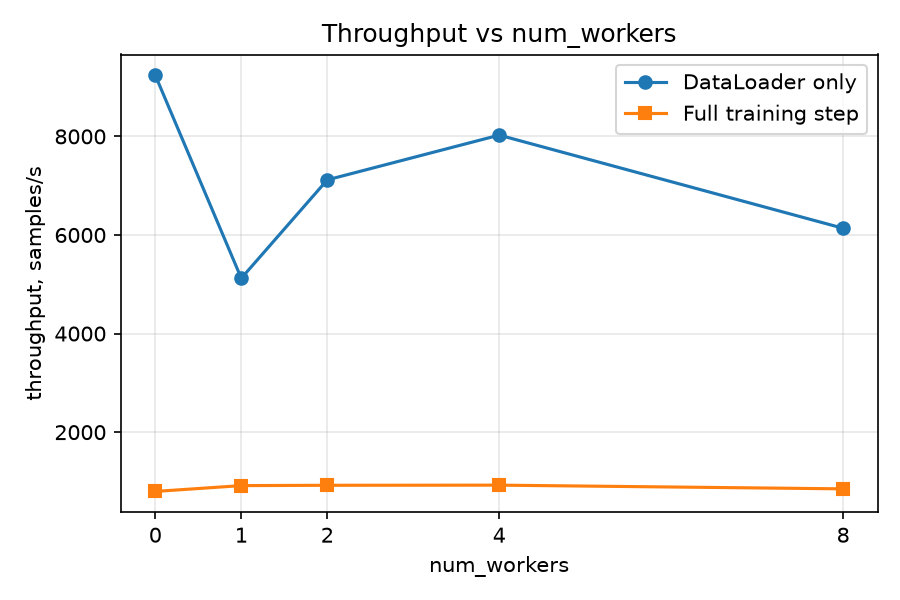
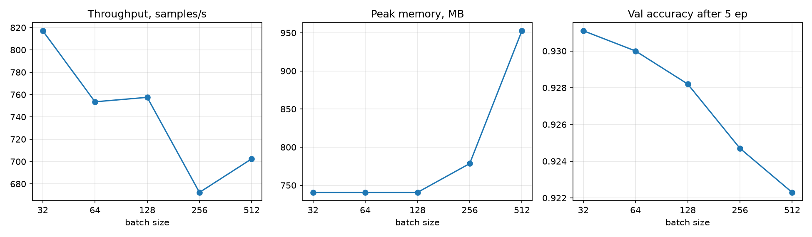
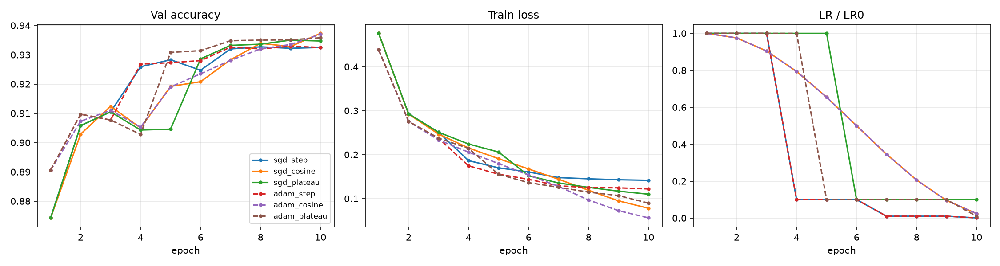
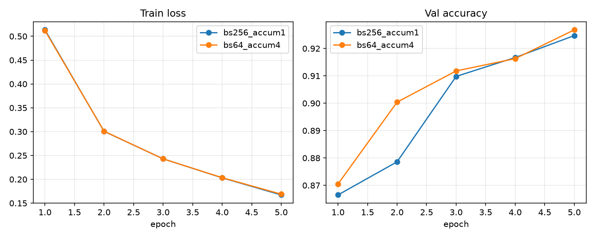
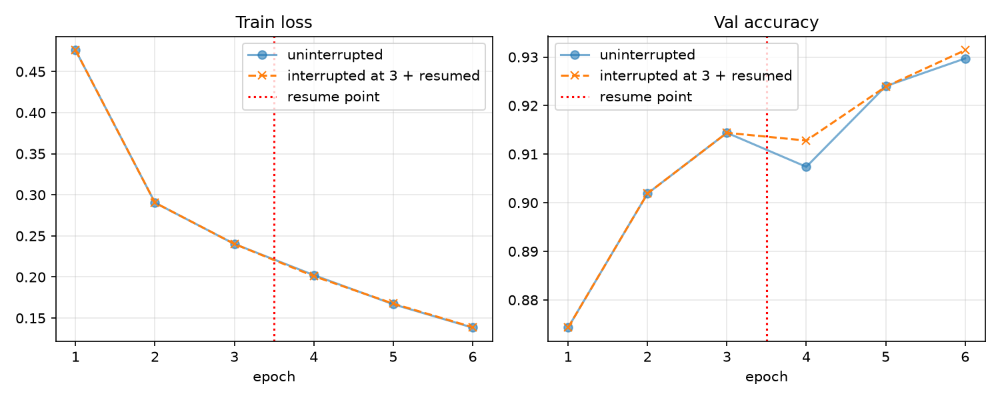

# Lab 6 — Training pipelines and project proposal

**Student:** ___________ (ID ___________)
**Device:** CPU (laptop, NVIDIA GTX 1650 not used)   **Dataset:** FashionMNIST (60 000 train / 10 000 test, 28×28, 10 classes)
**Base model:** best CNN from Lab 3 (`Lab3CNN` in `src/lab06.py`), ≈0.29 M parameters.

All code is in a single file `src/lab06.py`. All settings are in `src/config.yaml`.

---

## 1. Reproducible YAML-driven pipeline
- **Single config object:** every setting (data, model, optimizer, scheduler, checkpoints, MLflow) lives in
  `src/config.yaml`. Any field can be overridden from the command line, e.g. `--set train.epochs=5 data.batch_size=64`.
- **Reproducibility:** fixed `seed` for python / numpy / torch / cuda, `cudnn.deterministic=True`, a seeded
  DataLoader generator and a `worker_init_fn`.
- **Checkpoints:** saved every epoch (`last.pt`, `epoch_XXX.pt`, `best.pt`). Each one contains the model, optimizer,
  scheduler, RNG states, training history and the MLflow run id. Writes are atomic (`.tmp` + `os.replace`).
- **MLflow:** logs **params** (whole flattened config + device + number of parameters), **metrics** per epoch
  (train/val loss and accuracy, lr, samples/s, epoch time, peak memory) and **artifacts** (config.yaml,
  history.csv, best.pt).
- Evidence: `results/mlflow_runs.csv` (24 runs), screenshots `results/mlflow_runs.png`, `results/mlflow_charts.png`.

Baseline run: SGD (momentum 0.9, lr 0.05, wd 5e-4), CosineAnnealingLR, batch 128, 10 epochs.

| run | epochs | final train acc | final val acc | best val acc | epoch time |
|---|---|---|---|---|---|
| baseline | 10 | 0.9749 | 0.9373 | 0.9373 | 60–75 s |

---

## 2. Profiling one epoch (torch.profiler)
Setup: batch 128, num_workers = 2, CPU. Each phase of the training step was wrapped in `record_function(...)`,
and the per-phase time was taken from `prof.key_averages()`.
Files: `results/profile/profile_breakdown.csv`, `results/profile/profiler_top_ops.txt`, `results/profile/trace.json`.

| Phase | Time, ms | Share, % |
|---|---|---|
| Data loading | 5 488 | 7.3 |
| Forward | 27 478 | 36.7 |
| Backward | 41 185 | 55.0 |
| Optimizer step | 738 | 1.0 |
| **Total** | **74 889** | **100** |

**Conclusion.** About 92% of the epoch is spent on computation (forward + backward), so training is compute-bound.
Backward takes about 1.5× as long as forward, as expected, because it computes gradients with respect to both the
activations and the weights. The optimizer step is negligible (1%) because the model is small (≈0.29 M parameters).
Data loading takes only 7% with 2 workers, so it is not the bottleneck.

---

## 3. num_workers study

| num_workers | DataLoader only, samples/s | Full training, samples/s | Epoch time, s |
|---|---|---|---|
| 0 | 9 239 | 798 | 75.2 |
| 1 | 5 122 | 916 | 65.5 |
| 2 | 7 118 | 922 | 65.1 |
| 4 | 8 026 | 925 | 64.9 |
| 8 | 6 136 | 850 | 70.6 |

**Bottleneck: computation (CPU), not data loading.** Even in its slowest setting the DataLoader alone delivers
5–9 k samples/s, which is 6–10× more than the training step can consume (~0.8–0.9 k samples/s).

- **0 → 1 worker:** training speeds up by ~15% (798 → 916 samples/s), because batches are now prepared in a separate
  process in parallel with forward/backward instead of blocking the main process.
- **1 → 4 workers:** throughput is flat (~920 samples/s). More workers cannot help when the model computation is
  already the limit.
- **8 workers:** throughput drops to 850 samples/s (−8%), because the worker processes compete with PyTorch's
  compute threads for the same CPU cores.
- **The DataLoader-only curve** is highest at 0 workers because FashionMNIST is small and kept in memory. With
  workers, every batch must be passed between processes (pickling / IPC), and on Windows the workers also start
  slowly (spawn).

**Chosen value:** num_workers = 2. Its throughput is within 0.5% of the best value while it uses fewer CPU resources.

---

## 4. Batch-size study (5 epochs, lr scaled linearly: lr = 0.05·bs/128)

| Batch | LR | Throughput, samples/s | Peak memory, MB | Val acc after 5 ep |
|---|---|---|---|---|
| 32 | 0.0125 | 817 | 741 | 0.931 |
| 64 | 0.025 | 754 | 741 | 0.930 |
| 128 | 0.05 | 758 | 741 | 0.928 |
| 256 | 0.1 | 672 | 778 | 0.925 |
| 512 | 0.2 | 702 | 953 | 0.922 |

**Throughput.** On the CPU, a larger batch does **not** speed up training: throughput even drops from 817 to
~670–700 samples/s. A GPU gains from large batches because it gets more parallel work, but the CPU is already fully
loaded at batch 32. Larger activation tensors also stop fitting into the CPU cache.

**Peak memory.** On the CPU this is the peak memory of the whole process (Python + PyTorch + the dataset), so there
is a fixed baseline of ~740 MB. For batch ≤ 128 the activations are too small to show above it. From batch 256
onward, memory grows with the batch size: batch 512 adds ~210 MB of activations and gradients.

**Accuracy.** Accuracy after a fixed 5-epoch budget decreases slightly as the batch grows (0.931 → 0.922). A larger
batch means fewer optimizer updates (9 375 steps with batch 32 vs 590 with batch 512). The linear LR scaling only
partly compensates for this, and the high LR of 0.2 makes the first epoch noticeably worse (val acc 0.814 vs 0.889).

**Best trade-off on this hardware:** batch 32–64 gives both the highest throughput and the highest accuracy. On a
GPU, the optimum would shift towards larger batches.

---

## 5. LR schedules and optimizers (10-epoch budget)

| Optimizer | Scheduler | LR0 | Final val acc | Best val acc | Final train loss | Total time, s |
|---|---|---|---|---|---|---|
| SGD + momentum 0.9 | StepLR (step 3, γ 0.1) | 0.05 | 0.9325 | 0.9327 | 0.142 | 869 |
| SGD + momentum 0.9 | CosineAnnealingLR | 0.05 | **0.9373** | **0.9373** | 0.078 | 900 |
| SGD + momentum 0.9 | ReduceLROnPlateau | 0.05 | 0.9347 | 0.9350 | 0.110 | 967 |
| Adam | StepLR (step 3, γ 0.1) | 1e-3 | 0.9325 | 0.9329 | 0.122 | 981 |
| Adam | CosineAnnealingLR | 1e-3 | 0.9370 | 0.9370 | 0.056 | 987 |
| Adam | ReduceLROnPlateau | 1e-3 | 0.9358 | 0.9358 | 0.090 | 884 |

**Schedulers.**
- **CosineAnnealingLR** is the best for both optimizers (0.937). The LR decreases smoothly to almost zero by the last
  epoch, so the model makes large steps at the start and fine-tunes at the end.
- **StepLR (step 3)** decays the LR too early for a 10-epoch budget: by epoch 7 the LR is already 100× smaller, and
  accuracy stops improving at ~0.932–0.933.
- **ReduceLROnPlateau** reacts only after stagnation. For SGD, val loss did not improve in epochs 4–5, so the LR was
  reduced 10× at epoch 6, which immediately raised accuracy from 0.905 to 0.929. For Adam, the LR was reduced at
  epoch 5 (val acc 0.903 → 0.931) and again before epoch 10. For both optimizers it ends between StepLR and Cosine
  (0.935–0.936).

**SGD + momentum vs Adam.** Adam converges faster at the start (val acc after epoch 1: 0.891 vs 0.874). Under an
equal 10-epoch budget with the best scheduler (cosine), both reach the same accuracy (0.937). Adam fits the training
set more strongly (train loss 0.056 vs 0.078, train acc 0.984 vs 0.975), so its train–val gap is larger, which is a
sign of slightly stronger overfitting. All runs took a similar time (870–990 s); the differences are noise from
laptop load. **Chosen setup:** SGD + momentum + CosineAnnealingLR.

---

## 6. Gradient accumulation (batch 64 × 4 vs batch 256)

Both runs: lr 0.1 (0.05·256/128), CosineAnnealingLR, 5 epochs, same seed and the same shuffling order.

| Epoch | Train loss, bs256 | Train loss, bs64×4 | Val acc, bs256 | Val acc, bs64×4 |
|---|---|---|---|---|
| 1 | 0.5134 | 0.5120 | 0.8665 | 0.8705 |
| 2 | 0.3007 | 0.3010 | 0.8786 | 0.9004 |
| 3 | 0.2430 | 0.2429 | 0.9098 | 0.9118 |
| 4 | 0.2031 | 0.2034 | 0.9167 | 0.9163 |
| 5 | 0.1673 | 0.1689 | 0.9247 | 0.9268 |

| Setup | Final train loss | Final val acc | samples/s |
|---|---|---|---|
| batch 256, accum 1 | 0.1673 | 0.9247 | 719 |
| batch 64, accum 4 | 0.1689 | 0.9268 | 949 |

max |Δ train loss| over epochs = **0.0016**, max |Δ val acc| = **0.022** (epoch 2 only; ≤ 0.004 in the other epochs).

**Conclusion.** The training curves are practically identical (train loss differs by at most 0.0016), so
accumulating gradients over 4 micro-batches of 64 correctly emulates batch 256: the loss is divided by
`accum_steps`, and `optimizer.step()` is called once per 4 micro-batches. The remaining small differences come from
**BatchNorm**, which computes batch statistics over 64 samples instead of 256 and updates its running statistics
4× more often. This mainly affects validation accuracy in the early epochs. On the CPU the accumulated version was
even faster (949 vs 719 samples/s), consistent with Task 4, where small batches were faster on this hardware. On a GPU,
the main benefit of accumulation is lower activation memory for the same effective batch.

---

## 7. Checkpoint recovery

Training (6 epochs, cosine) was stopped after epoch 3 (`train.stop_after_epoch=3`) and resumed from
`results/checkpoints/resume_demo/last.pt`. Model, optimizer, scheduler and RNG states were restored, and the same
MLflow run continued (one continuous curve in the UI). It was compared with an uninterrupted run with the same seed
(`results/resume/resume_vs_full.csv`):

| Epoch | Train loss, full | Train loss, resumed | Val acc, full | Val acc, resumed | abs diff val acc |
|---|---|---|---|---|---|
| 1 | 0.4760 | 0.4760 | 0.8743 | 0.8743 | 0.0000 |
| 2 | 0.2904 | 0.2904 | 0.9019 | 0.9019 | 0.0000 |
| 3 | 0.2402 | 0.2402 | 0.9144 | 0.9144 | 0.0000 |
| *resume* | | | | | |
| 4 | 0.2023 | 0.2010 | 0.9074 | 0.9128 | 0.0054 |
| 5 | 0.1668 | 0.1676 | 0.9240 | 0.9239 | 0.0001 |
| 6 | 0.1384 | 0.1389 | 0.9297 | 0.9314 | 0.0017 |

**Conclusion.** The curves continue smoothly, with no jump in loss or LR after the resume. The LR schedule continues
exactly (0.025 → 0.0125 → 0.0033 in both runs), which confirms that the scheduler state was restored. Train loss
after resuming differs from the uninterrupted run by ≤ 0.0013 and val accuracy by ≤ 0.5 pp. These small deviations
most likely come from non-deterministic floating-point summation order in multi-threaded CPU kernels and from the
DataLoader worker processes being re-created. They are within normal run-to-run noise.

---

## 8. Individual project proposal
See `../project/README.md`.

---

## How to reproduce
    cd lab06
    python src/lab06.py train
    python src/lab06.py profile
    python src/lab06.py workers
    python src/lab06.py batch
    python src/lab06.py sched
    python src/lab06.py accum --set train.epochs=5 train.lr=0.1
    python src/lab06.py resume --set train.epochs=6
    python src/lab06.py export
    mlflow ui --backend-store-uri sqlite:///mlflow.db